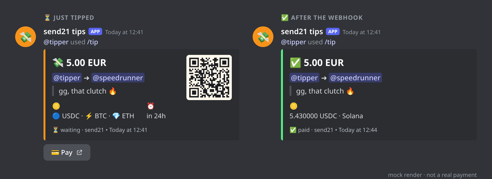
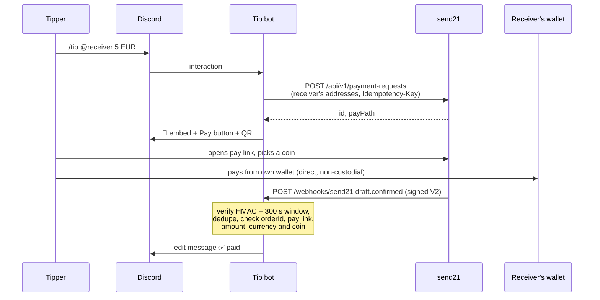

# send21 Discord tip bot 💸

**`/tip @someone 5 EUR`: a crypto tip that lands straight in their own wallet.** Built on [send21](https://send21.io), crypto pay links and API for people and AI agents.



<sub>Mock render ([docs/embed-mock.html](docs/embed-mock.html)), not a real payment.</sub>

- 🪙 BTC (on-chain and ⚡ Lightning), USDC, USDT, EURC, SOL, ETH
- 🔒 Non-custodial: the bot and send21 never hold the money or any keys
- ✅ The message flips to *paid* when a signed webhook confirms it

## Quickstart

1. **Discord app.** In the [Developer Portal](https://discord.com/developers/applications), create an app and add a bot. Copy the token and the application id. Invite it with
   `https://discord.com/oauth2/authorize?client_id=<APP_ID>&scope=bot+applications.commands&permissions=51200`
   (View Channels, Send Messages, Embed Links, Attach Files).
2. **send21 key.** On [send21.io/api-keys](https://send21.io/api-keys), create a key with `drafts:write` (add `webhooks:manage` for step 4).
3. **Install.**
   ```bash
   cp .env.example .env   # fill in DISCORD_TOKEN, DISCORD_APP_ID, SEND21_API_KEY, PUBLIC_URL
   npm install
   npm run register       # pushes /tip and /tipme (set DISCORD_GUILD_ID for instant updates)
   ```
4. **Webhook.** Put the bot behind your own HTTPS address (for example a reverse proxy with a free Let's Encrypt certificate; send21 refuses private addresses). Then:
   ```bash
   npm run webhook:register   # prints SEND21_WEBHOOK_SECRET once: paste it into .env
   ```
5. **Run.** `npm run build && npm start`. In Discord: `/tipme set` once, then `/tip`.

🧪 **No key yet?** Leave `SEND21_API_KEY` empty and run `npm run dev`. Mock mode makes no send21 calls; the Pay button opens a local page where you can simulate *paid*, *short* or *expired*.

## Commands

| | |
| --- | --- |
| `/tip user amount currency [note]` | 💸 Post a tip with a Pay button and a QR |
| `/tipme set coin address` | ➕ Add a coin and **your own** receiving address |
| `/tipme show` / `/tipme remove` | 👀 / 🗑️ Only you see the answer |

## How it works

Every user sets their own receiving addresses with `/tipme set` (for example USDC on Solana and a Lightning address). `/tip` creates one send21 **payment request**: a pay link priced in the fiat currency you picked, offering exactly the receiver's coins and addresses. The tipper opens the link, picks a coin (the rate locks for 15 minutes) and pays from their own wallet, straight to the receiver. send21 watches the chain and sends signed webhooks; the bot checks them and edits the message. The tipper never types an address and the bot never touches the money.



| Webhook | Message |
| --- | --- |
| `draft.seen` | 👀 on its way |
| `draft.confirmed` (matches the tip) | ✅ paid |
| `draft.confirmed` (does **not** match) | 🚩 check, never ✅ |
| `draft.amount_mismatch` | ⚠️ different amount, admin decides |
| `draft.mismatch_accepted` → `draft.confirmed` | 👍 → ✅ paid · ≈ accepted |
| `draft.mismatch_rejected` | ↩️ declined, refund is manual |
| `draft.mismatch_unresolved` | ⚠️ expired undecided |
| `payment_request.expired`, `draft.expired` | ⌛ expired |

Payments within `TIP_SHORTFALL_PERCENT` (default 2%) short, such as exchange withdrawal fees, are accepted automatically through send21's `shortfallPolicy`. Other different amounts wait for the owner of the bot's send21 account to accept or decline them on send21.

**Fees.** The bot's send21 account (the server admin) pays one small send21 fee per paid tip (0.49% on small payments, at least $0.01). The receiver always gets the full amount. See [pricing](https://send21.io/pricing).

## Security notes

- **Signature V2 only.** Every delivery is checked with `X-Send21-Signature-V2`: HMAC-SHA256 over `<t>.<delivery id>.<raw body>`, constant-time compare, refused when more than **300 s** old or in the future. The legacy body-only header is not accepted. Bad signature → `401`, nothing stored.
- **Dedupe on both sides.** send21 dedupes on its side (retries reuse the same `X-Send21-Delivery` id, and one pay link is one payment). The receiver still runs its own duplicate check: a delivery id, or the same event body under a new id, is applied once. The delivery id and the tip update are written together, before the `2xx`, so a restart cannot apply it twice. If the write fails the bot answers `500` and send21 retries.
- **Checked before ✅.** A `draft.confirmed` must match the stored tip: `orderId`, pay link id, fiat currency, fiat amount (integer minor units), a coin and network the receiver offered, a txId and `status: Confirmed`. Anything else is 🚩, never ✅. Paid is final; late or out-of-order events never undo it.
- **Receivers set their own address.** Addresses are shape-checked per network. Anything that looks like a seed phrase or private key is refused. send21 never asks for one; nobody should.
- **Small surface.** Only the `Guilds` intent. Notes are one line, max 80 characters, with no links, no mentions and no hidden or bidi characters. The public pay page memo has no Discord names. Tips are rate-limited per user. The API key stays on the server and is never logged; a send21 key cannot move funds anyway.
- **Data.** One JSON file (`DATA_FILE`, mode 600) with user ids, receiving addresses, tips and delivery ids. For several processes, use SQLite or Postgres instead.

## Develop

```bash
npm run check    # typecheck + lint + tests
npm run send-sample -- draft.confirmed   # signed sample delivery for the newest tip
```

API reference: [send21.io/docs](https://send21.io/docs) · [webhooks](https://send21.io/docs/webhooks) · [llms-full.txt](https://send21.io/llms-full.txt). More examples: [send21-examples](https://github.com/send21io/send21-examples).

Questions: [info@send21.io](mailto:info@send21.io). License: [MIT](LICENSE).
